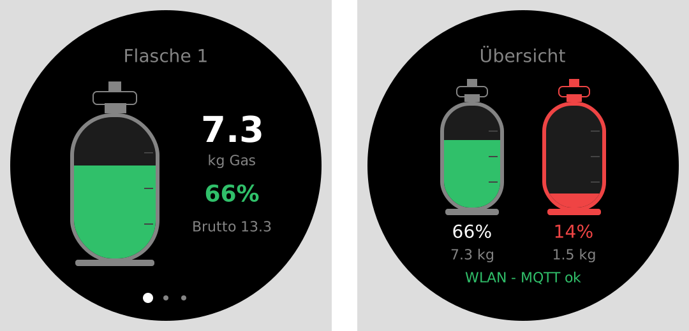
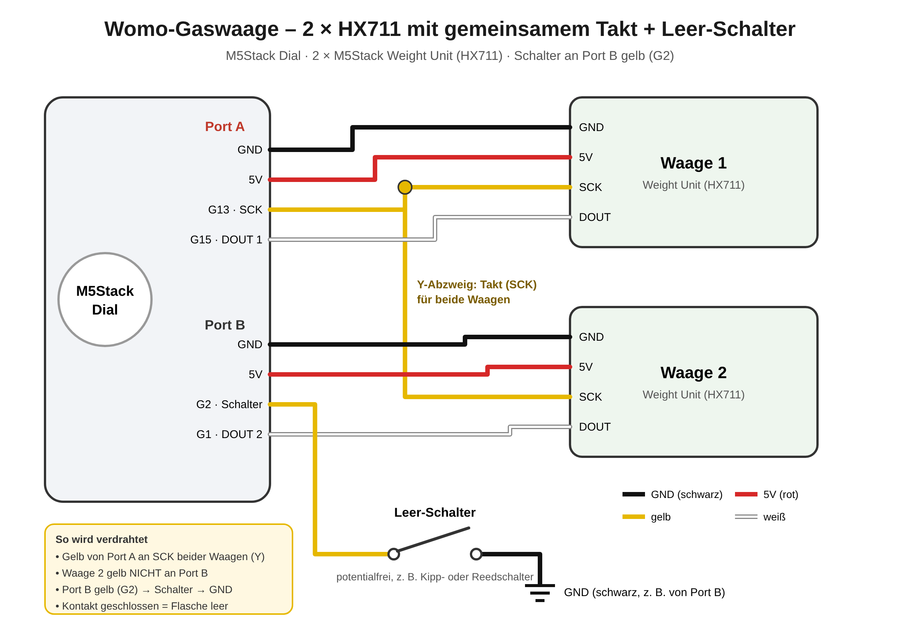

# Womo-Gaswaage

**Zwei Gasflaschen wiegen statt schätzen** – mit einem M5Stack Dial und zwei M5Stack Weight Units.
Restgas in kg, Prozent und Litern, direkt am Drehdisplay, im Browser, in Home Assistant und im Victron Cerbo GX.

Ein Projekt der Telegram-Gruppe **SmartWomoHA** – *Help for free*.



---

## Funktionen

- **2 Gasflaschen** gleichzeitig, je eigene Waage (Port A und Port B)
- **Restgas in kg, %, Liter** – Liter temperaturkorrigiert über ein externes Thermometer
- **Gasflaschen-Grafik** am Display und in der Weboberfläche, Farbe grün / orange / rot
- **Bedienung am Drehring**: Leergewicht, Gasmenge, Warnschwelle, Nullen, Kalibrieren
- **Leer-Schalter (optional)**: ein Kontakt meldet „Flasche sicher leer“ – im Setup wählbar, mit Schaltplan
- **Warnung „Nachfüllen“** mit Piepton (abschaltbar) und Hinweis **„Zu kalt für Propan/Butan“**
- **Setup-WLAN** zum Einrichten – keine Zugangsdaten im Code, eine `.bin` für alle
- **Home Assistant** per MQTT Auto-Discovery
- **Victron Cerbo GX / MQTT** – erscheint als echter **LPG-Tank** im VRM (MQTT-Schema `tank_sensor`)
- **Weboberfläche**, **OTA-Update** (VS Code oder im Browser unter `/update`), Werte bleiben nach Stromausfall erhalten

## Hardware

| Teil | Hinweis |
|---|---|
| M5Stack Dial (ESP32-S3) | Display, Drehring, Taster, Summer |
| 2 × M5Stack Weight Unit (HX711) | Waage 1 an **Port A**, Waage 2 an **Port B** |
| 2 × Wägezelle | mind. **50 kg** je Flasche (11-kg-Flasche ≈ 25 kg brutto) |
| Stromversorgung | USB-C oder 6–36 V über die Klemme des Dial |
| Leer-Schalter (optional) | potentialfreier Kontakt, z. B. Kipp- oder Reedschalter |

Pinbelegung (aus dem M5Stack-Datenblatt): Port A G15 (weiß, DOUT) / G13 (gelb, SCK),
Port B G1 (weiß, DOUT) / G2 (gelb, SCK). Ist die Richtung vertauscht, erkennt die Firmware das beim Start.

### Leer-Schalter (optional)

Der Dial hat nur Port A und Port B. Damit ein Pin für den Schalter frei wird, teilen sich beide Waagen
die Taktleitung. Im Setup unter **Verdrahtung und Leer-Schalter** → *2 Waagen + Leer-Schalter* wählen –
der passende Schaltplan wird dort direkt angezeigt.



| Draht | Anschluss |
|---|---|
| Port A gelb (G13) | CLK von **Waage 1 und Waage 2** (Y-Kabel) |
| Port A weiß (G15) | DAT Waage 1 |
| Port B weiß (G1) | DAT Waage 2 |
| Port B gelb (G2) | Schalter → GND |
| Rot / Schwarz | 5 V / GND je Waage wie gewohnt |

- Wählbar: zu welcher Flasche der Schalter gehört und ob *geschlossen* oder *offen* „leer“ bedeutet.
- Meldet der Schalter „leer“: Füllstand 0 %, „Gas niedrig“, Alarmton, Anzeige **LEER (Schalter)**.
  Das Bruttogewicht wird weiter gemessen.
- Am Dial: **Systemmenü → Anschluss** zeigt die Belegung und den Schalterzustand live.
- Erst stromlos umverdrahten, dann umstellen und speichern (die Waage startet neu).

## Schnellstart

### 1. Flashen – eine Datei
`womo-waage-factory.bin` aus den [Releases](../../releases) laden (oder selbst bauen, siehe unten).

1. Dial per USB-C anschließen (echtes Datenkabel).
2. In Chrome/Edge https://espressif.github.io/esptool-js/ öffnen → **Connect**.
3. **Erase Flash**, dann die Datei an Adresse **0x0** → **Program**.

### 2. Einrichten
1. Der Dial öffnet das WLAN **WomoWaage-Setup-XXXX** – Passwort **`smartwomo`**.
2. Mit dem Handy verbinden, die Setup-Seite öffnet sich (sonst http://192.168.4.1).
3. WLAN wählen, MQTT-Broker eintragen (Home Assistant **oder** Cerbo GX), Gasart wählen → **Speichern**.

Setup später erneut öffnen: am Dial **Übersicht → Drücken → WLAN-Setup** (10 min) oder `http://<IP>/setup`.
Ist das WLAN länger als 60 s weg, startet das Setup-WLAN automatisch.

### 3. Einmessen (je Waage einmal)
1. **Nullen** – Waage leer → Menü → *Nullen*.
2. **Kalibrieren** – Menü → *Kalibrieren* → Gewicht des Prüfstücks einstellen (z. B. 5,0 kg) → auflegen → drücken.
3. **Flasche** – *Leergewicht* (steht als „TG“ auf der Flasche) und *Gasmenge voll* (z. B. 11 kg) eintragen.

## Bedienung am Dial

| Aktion | Wirkung |
|---|---|
| Drehen | Flasche 1 → Flasche 2 → Übersicht |
| Kurz drücken | Menü der Flasche (in der Übersicht: Systemmenü) |
| Lang drücken | zurück / abbrechen |

- **Flaschenmenü:** Leergewicht · Gasmenge voll · Warnung bei · Nullen · Kalibrieren
- **Systemmenü:** Alarmton an/aus · WLAN-Setup · Info · Anschluss · Helligkeit

Schnell drehen = große Schritte. Nach 1 Minute dunkelt das Display ab.

## Temperatur und Gasart

Die Waage misst die **Masse** – kg und % stimmen bei jeder Temperatur.
Von der Temperatur abhängig sind:

- **Liter**: kaltes Flüssiggas ist dichter (Propan 0,528 kg/L bei 0 °C, 0,499 kg/L bei 20 °C).
  11 kg Propan ≈ 21–22 L.
- **Verdampfung**: bei Kälte reicht der Druck nicht mehr –
  Butan ab ≈ 0 °C, Gemisch ab ≈ −10 °C, Propan ab ≈ −30 °C → Hinweis **„Zu kalt“**.

Temperatur zuführen (eine Möglichkeit genügt):

| Quelle | Einstellung |
|---|---|
| MQTT-Thermometer, Victron-Fühler | Setup → *Externes Thermometer: MQTT-Topic* (Zahl oder JSON) |
| Home Assistant | Automation aus [`examples/ha-automation-aussentemperatur.yaml`](examples/ha-automation-aussentemperatur.yaml) → sendet an `womo-waage/temp/set` |
| MQTT-Bridge | `cmd` `{"ambient_temp_c": -4.5}` |

Ein Wert gilt 1 Stunde, danach wird mit 15 °C gerechnet.

## Home Assistant

Voraussetzung: MQTT-Integration und Broker (z. B. Mosquitto). Das Gerät erscheint automatisch als **Womo Gaswaage**.

| Je Flasche | Für das Gerät |
|---|---|
| Gas (kg), Füllstand (%), Restmenge (L) | Alarmton (Schalter) |
| Gewicht brutto (Diagnose) | Gas zu kalt (Binärsensor) |
| Gas niedrig (Binärsensor) | Außentemperatur (verwendet) |
| Leergewicht, Gasmenge voll, Warnschwelle (Zahl) | |
| Nullen (Taste) | Leer (Schalter) – nur mit Leer-Schalter |

## Victron Cerbo GX / MQTT

Im Setup unter **MQTT-Format**: *MQTT-Bridge + Home Assistant*, *nur MQTT-Bridge* oder *nur Home Assistant*.
Broker = IP des Cerbo GX, **MQTT-Geräte-ID** = Seriennummer der MQTT-Bridge.

| Topic | Inhalt |
|---|---|
| `occ/<serial>/tank_sensor/gas_scale_1/config` | Selbstauskunft (retained): `tank_sensor`, `fluid: lpg`, Felder |
| `occ/<serial>/tank_sensor/gas_scale_1/state` | `gas_level_pct`, `gas_volume_l`, `gas_kg`, `gross_kg`, `tare_kg`, `capacity_kg`, `warn_pct`, `low`, `gas_cold`, `ambient_temp_c`, `alarm_sound`, `empty_switch` (nur mit Leer-Schalter) … |
| `occ/<serial>/tank_sensor/gas_scale_1/diagnostics` | Rohwert, Faktor, GPIOs, IP, WLAN, Laufzeit |
| `occ/<serial>/tank_sensor/gas_scale_1/availability` | `online` / `offline` |
| `occ/<serial>/tank_sensor/gas_scale_1/cmd` | `{"tare_kg":6.2}` `{"capacity_kg":11}` `{"warn_pct":15}` `{"zero":true}` `{"calibrate_kg":5}` `{"alarm_sound":false}` |

Die Topic-Wurzel `occ` erwartet die MQTT-Bridge im Cerbo GX; sie steht als `MQTT_ROOT` in `include/config.h`.

Flasche 2 unter `gas_scale_2`. Die MQTT-Bridge baut daraus einen **Victron-Tank „Gas (LPG)“** mit Balken und Restmenge.

## Weboberfläche

- `http://<IP>` – Flaschen-Grafik, Werte, Einstellungen, Nullen, Kalibrieren, Alarmton
- `http://<IP>/setup` – WLAN, MQTT, Gasart, Thermometer, Gerät, Werkseinstellungen
  (im Heimnetz mit Admin-Passwort, Benutzer `admin`)

## Selbst bauen

VS Code mit der Erweiterung **PlatformIO IDE**, den Projektordner öffnen (der mit `platformio.ini`) → **Build ✓**.

Ergebnis im Ordner `firmware/`:
- `womo-waage-factory.bin` – alles in einer Datei, an **0x0** flashen
- `womo-waage-ota.bin` – nur die App, für Updates per WLAN

**Update per WLAN:** in `platformio.ini` unter `[env:ota]` die IP und bei `--auth=` das Admin-Passwort eintragen,
dann PlatformIO → *ota* → **Upload** (oder `pio run -e ota -t upload`).

**GitHub Actions:** `.github/workflows/build.yml` baut bei jedem Push.
Ein Tag wie `v1.5.0` erstellt automatisch ein Release mit beiden `.bin`-Dateien und der SBOM.

Hardware- und Standardwerte stehen in `include/config.h`
(Pins, Mittelwert, Standard-Leergewicht, Dimmzeit, `ENC_COUNTS_PER_STEP` für den Drehring).

## Projektstruktur

```
womo-waage/
├── platformio.ini            Build-Konfiguration (USB und OTA)
├── partitions.csv            Speicheraufteilung 2 × 3,9 MB (OTA)
├── src/main.cpp              WLAN, Setup, MQTT (HA + MQTT-Bridge), Web, Temperatur
├── include/
│   ├── config.h              Einstellungen
│   ├── scale.h               HX711 (auch gemeinsamer Takt), Nullen, Kalibrieren, Gasberechnung
│   ├── ui.h                  Display und Drehring
│   └── web_pages.h           Weboberfläche
├── scripts/merge_bin.py      erzeugt die eine Flash-Datei
├── examples/                 Home-Assistant-Automation
├── docs/                     Bilder
├── sbom.cdx.json             Software-Stückliste (CycloneDX)
└── .github/workflows/        automatischer Build
```

## Fehlersuche

| Problem | Lösung |
|---|---|
| „Sensor fehlt“ | Kabel und Port prüfen. Serieller Monitor (115200) zeigt `[waage1] Pegel …` |
| Werte springen | Wägezelle mechanisch entkoppeln, Kabel nicht an Leistungsleitungen entlang |
| Drehring reagiert erst nach 2 Rasten | `ENC_COUNTS_PER_STEP` in `config.h` auf 2 |
| Nicht in Home Assistant | MQTT-Broker/Benutzer im Setup prüfen, Format nicht auf „nur MQTT-Bridge“ |
| Nicht im VRM | MQTT-Geräte-ID = Seriennummer der Bridge, `devices` in der Spec auf `auto` oder `tank_sensor/gas_scale_1` |
| OTA: `No response` | Mac-Firewall: Python erlauben, IP statt `.local` verwenden |

## Freischaltung

Jedes Gerät hat einen eigenen **8-stelligen Freischaltcode**, gebunden an seine MAC-Adresse.
**Die Freischaltung ist kostenlos.** Sie dient nur dazu, dass ich weiß, wer die Software nutzt:
Namen und MAC-Adresse an SmartWomoHA (Telegram-Gruppe) schicken, den Code bekommst du zurück.
Wer damit nicht einverstanden ist, nutzt die Software bitte nicht.
Die MAC steht im Setup unter **Freischaltung**; dort wird auch der Code eingetragen.
Ohne Code zeigen Display und Weboberfläche nur, ob die Waagen **verbunden** sind – **keine Werte**, kein MQTT-Wert, Nullen/Kalibrieren/Einstellen gesperrt.

Zum Bauen mit Freischaltung braucht es `include/license_secret.h` (geheim, steht in `.gitignore`).
Fehlt die Datei, lässt sich die Firmware trotzdem bauen; das Gerät bleibt dann gesperrt.
Logik: `include/license.h`.

## Nutzungsbedingungen

Die Software ist kostenlos und wird **ohne Haftung** bereitgestellt. Die Hardware kaufst du selbst und baust sie
selbst auf – auf eigenes Risiko. Unterstützung gibt es gern und freiwillig in der Telegram-Gruppe **SmartWomoHA**.
Details: [`NUTZUNGSBEDINGUNGEN.md`](NUTZUNGSBEDINGUNGEN.md)

## SBOM

`sbom.cdx.json` (CycloneDX 1.6) listet alle Komponenten mit Version und Lizenz.
Die Versionen sind in `platformio.ini` gepinnt.

## Versionen

| Version | Änderungen |
|---|---|
| 1.7.0 | **Freischaltcode** (8 Zeichen, an die MAC gebunden, kostenlos; ohne Code verbunden, aber gesperrt); Bezeichnungen vereinheitlicht: Setup, Log und Doku sagen jetzt „MQTT“ bzw. „MQTT-Bridge“; Funktion, Topics und gespeicherte Einstellungen bleiben gleich |
| 1.6.0 | Verdrahtung wählbar: 2 Waagen ohne Schalter oder mit **Leer-Schalter** (gemeinsamer Takt), Schaltplan im Setup, Anzeige „Anschluss“ am Dial |
| 1.5.1 | Firmware-Update im Browser (`/update`), nach Speichern/Neustart automatisch zurück zur Startseite |
| 1.5.0 | Externes Thermometer, Gasart, temperaturkorrigierte Liter, Hinweis „Zu kalt“ |
| 1.4.0 | Gasflaschen-Grafik am Display und in der Weboberfläche |
| 1.3.0 | Alarmton abschaltbar (Display, Web, HA, MQTT) |
| 1.2.0 | MQTT-Schema wie Truma-Gasflasche (`tank_sensor`, `gas_level_pct`), Availability |
| 1.1.0 | MQTT im MQTT-Schema für die MQTT-Bridge / Victron Cerbo GX |
| 1.0.0 | Erste Version: 2 Waagen, Dial-Bedienung, Setup-WLAN, Home Assistant |

---

**SmartWomoHA** – Help for free · Fragen und Ideen gern in der Telegram-Gruppe.
